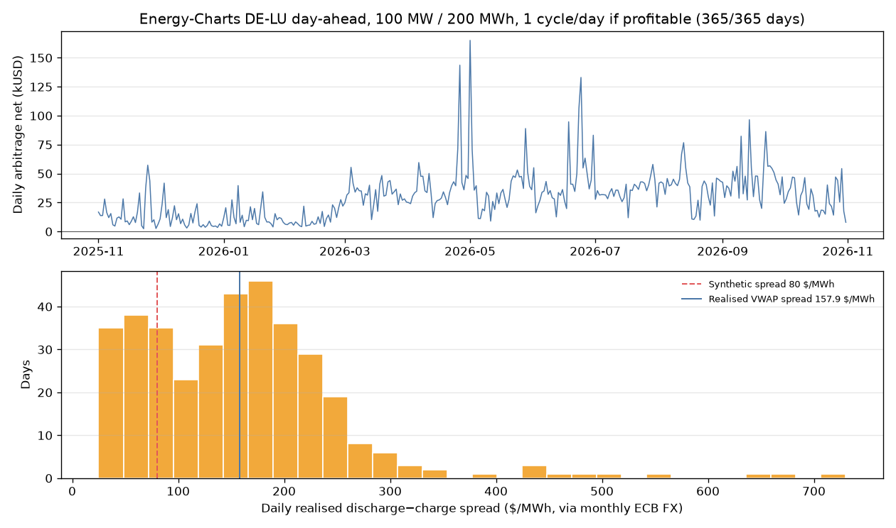
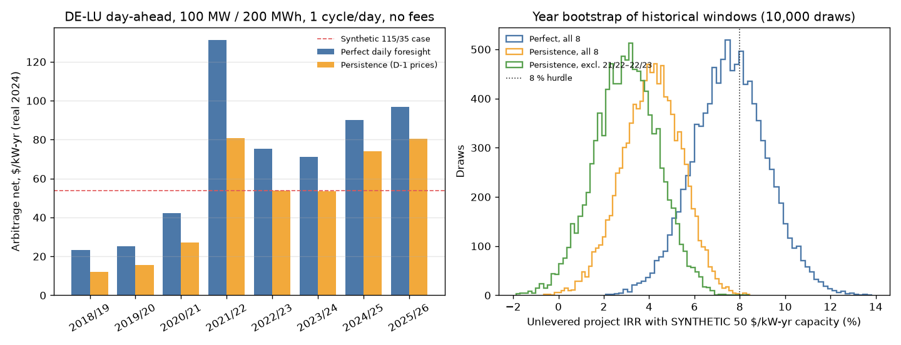
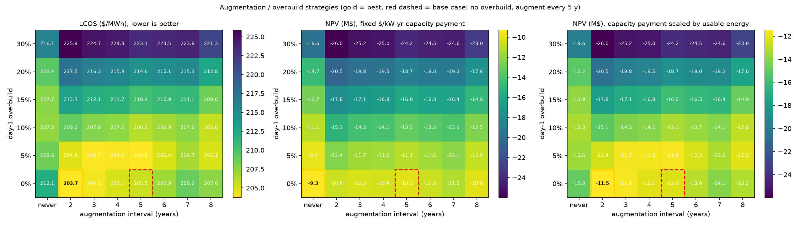
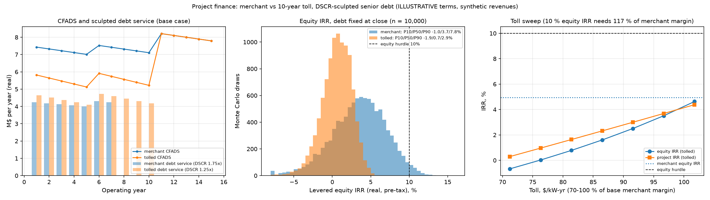
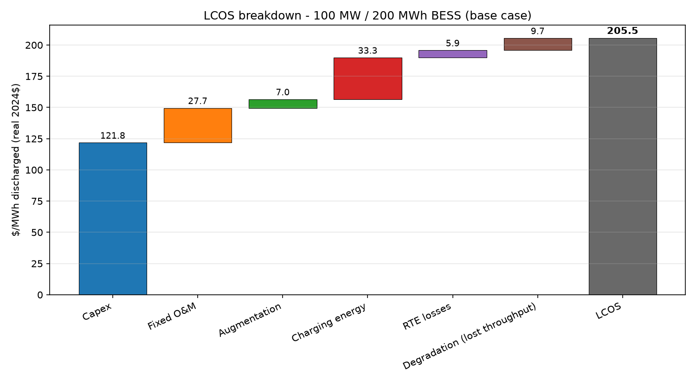
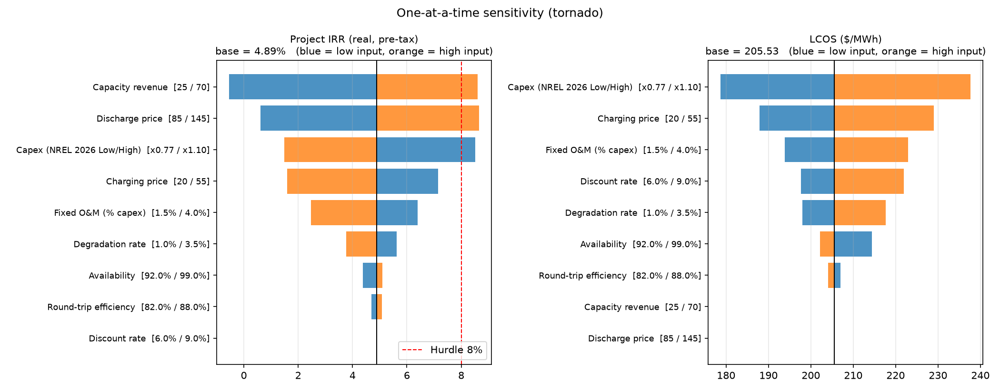
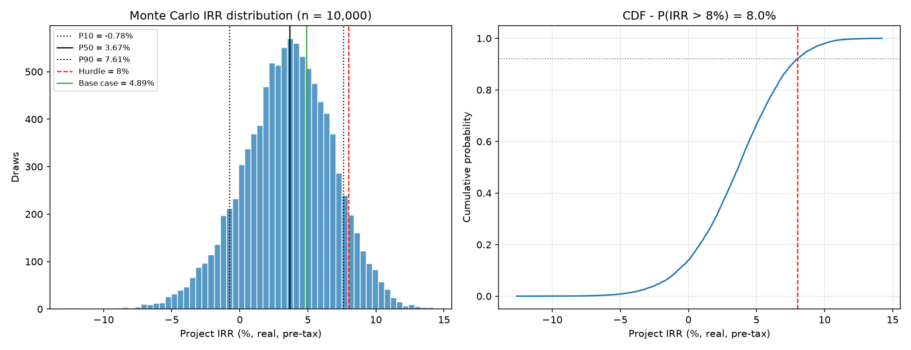
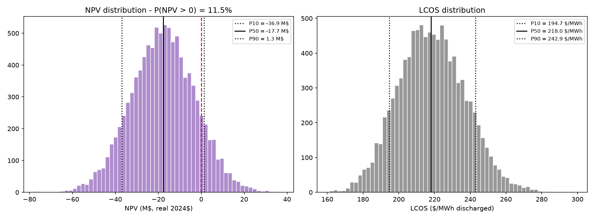
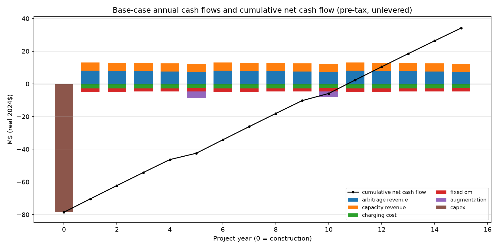

# BESS LCOS & Monte Carlo Project IRR

A compact, transparent **techno-economic toolkit for a utility-scale battery energy storage system (BESS)**:
Levelized Cost of Storage (LCOS) with a component breakdown, an annual project cash-flow model (NPV, IRR, payback),
one-at-a-time tornado sensitivity, a 10,000-draw Monte Carlo over the uncertain inputs, an
augmentation / overbuild strategy study that asks how a fading battery should be topped up, and a
**project-finance layer** (merchant vs tolling revenue, DSCR-sculpted senior debt, levered equity IRR).

Case study: **100 MW / 200 MWh (2-hour) lithium-ion BESS**, 15-year life, real 2024 US$, pre-tax, unlevered.
Capital cost inputs come from NREL's *Cost Projections for Utility-Scale Battery Storage: 2025 Update*.
Capacity / ancillary revenue is still **synthetic**. A measured Energy-Charts DE-LU day-ahead arbitrage path is compared with the synthetic 115/35 $/MWh case below, and is extended to eight years of history (2018/19–2025/26, real 2024 $) with a causal persistence rule and a year bootstrap. This remains a method study, not an investment case for a real project.

---

## Key results (base case, from `python run_all.py`)

| Metric | Value |
|---|---|
| Overnight capex | **78.57 M$** (785.7 $/kW · 392.8 $/kWh) |
| **LCOS** | **205.53 $/MWh** discharged |
| NPV @ 7 % real | **−10.08 M$** |
| Project IRR (real, pre-tax) | **4.89 %** (hurdle 8 %) |
| Simple payback | 10.72 years (discounted payback not reached within 15-year life) |
| Year-1 discharged energy | 70,101.9 MWh |
| Implied fixed O&M + augmentation | 3.12 % of capex/yr (NREL 2025 FOM benchmark incl. augmentation: 4 %) |

**Monte Carlo (n = 10,000, seed = 42)**

| | P10 | P50 | P90 |
|---|---|---|---|
| Project IRR | −0.78 % | 3.67 % | 7.61 % |
| NPV @ sampled discount rate | −36.93 M$ | −17.73 M$ | 1.34 M$ |
| LCOS ($/MWh) | 194.67 | 217.99 | 242.90 |

* **P(IRR > 8 % hurdle) = 8.0 %**, P(NPV > 0) = 11.5 %; IRR was defined in all 10,000 draws.
* **Biggest IRR driver (tornado): capacity revenue**, swinging IRR from −0.54 % to 8.61 % over 25–70 $/kW-yr,
  closely followed by the average discharge price (0.60 % to 8.66 %) and capex (8.51 % at the NREL Low multiplier
  to 1.48 % at the High multiplier).
* **Biggest LCOS driver: capex** (178.73 to 237.68 $/MWh across the NREL 2026 Low/High range), then charging price.
* Monte Carlo Spearman rank correlation with IRR: capacity revenue +0.55, discharge price +0.51, capex −0.41,
  charging price −0.34, fixed O&M −0.25, degradation −0.12 (others |ρ| < 0.05).
* The Monte Carlo P50 IRR (3.67 %) is below the base case (4.89 %) because several input distributions are
  deliberately skewed toward the downside (higher charging price, O&M and degradation; lower capacity revenue).

**Reading the result:** with these (synthetic) revenues, a 2-hour merchant battery at NREL's 2026 mid-case capex
does not clear an 8 % real hurdle. Revenue certainty (capacity/ancillary contracts, spreads) matters more than
efficiency or availability, and capex is the main lever on LCOS. Change `config/assumptions.yaml` to test your own case.

### Energy-Charts DE-LU day-ahead arbitrage path (2026-11-12)

The synthetic case uses constant 115 / 35 $/MWh discharge and charge prices (spread 80 $/MWh) and 365 cycles/year. This complement keeps that case unchanged and adds a **measured** path: Energy-Charts / SMARD DE-LU day-ahead hourly means, **2025-11-01 → 2026-10-31** (8,760 hours, Europe/Berlin, [CC BY 4.0](https://creativecommons.org/licenses/by/4.0/)), converted to USD with ECB monthly USD/EUR averages (period mean 1.158). Dispatch is daily perfect foresight, at most one cycle per day, 100 MW / 200 MWh, 85 % RTE: charge enough cheapest hours to cover \(E_\mathrm{dis}/\eta\) and discharge two full-power peak hours, only if the cycle is profitable. Fees, imbalance and grid charges are **not** included. The 15-year TEA still applies the 97 % availability haircut and fade, exactly as in the synthetic case. The 50 $/kW-yr capacity payment is **still SYNTHETIC** wherever it is used.



| | Synthetic 115/35 | Energy-Charts DA path |
|---|---:|---:|
| Days cycled (of 365) | 365 (assumed) | **365 / 365** (every day profitable under these rules) |
| Volume-weighted discharge price | 115 $/MWh | **210.20 $/MWh** |
| Volume-weighted charge price | 35 $/MWh | **52.35 $/MWh** |
| Spread | 80 $/MWh | **157.85 $/MWh** |
| Historical-window arbitrage net | — | **10.85 M$** (108.5 $/kW-yr) |
| LCOS | 205.53 $/MWh | **225.94 $/MWh** |
| Unlevered IRR, **with** synthetic 50 $/kW-yr capacity | **4.89 %** | **13.71 %** |
| NPV @ 7 % real, with synthetic capacity | −10.08 M$ | **+35.87 M$** |
| Simple payback, with synthetic capacity | 10.72 y | 6.29 y |
| Unlevered IRR, **arbitrage only** (capacity = 0) | −7.92 % | **4.97 %** |
| NPV @ 7 %, arbitrage only | −55.62 M$ | −9.67 M$ |

**Honest reading.** On this 12-month window the realised peak/trough spread is about **twice** the synthetic 80 $/MWh assumption, mainly because H2-2026 DE-LU prices include extremes (min −499, max 697.31 €/MWh; mean 111.26 €/MWh). That is why IRR with the *still-synthetic* capacity payment jumps from 4.89 % to 13.71 % and clears the 8 % hurdle. Two caveats matter more than the headline:

* **Without the synthetic capacity payment, the market-path IRR is 4.97 %** — almost the same as the old all-in synthetic 4.89 % — and still misses the 8 % hurdle (NPV −9.67 M$). The day-ahead path replaces the assumed capacity income; it does not, on its own, make the 2026 mid-case capex asset financeable at 8 %.
* LCOS **rises** (205.53 → 225.94 $/MWh) because the realised charging VWAP (52.35) is above the synthetic 35 $/MWh. IRR and LCOS move in opposite directions here because LCOS does not credit discharge revenue.
* The window is a single realised year with daily perfect foresight and no trading fees. It is not a price-forward or a typical year, and contemporaneous ECB FX is used rather than a 2024 USD deflator.

Run `python scripts/run_market_revenues.py` (no network required; the attributed panel is shipped). Results: `results/market_revenues.json`, `results/market_daily_dispatch.csv`.


### Eight years of DE-LU history, causal foresight and a year bootstrap (2026-11-22)

The 2026-11-12 path above is **one** window (2025/26) at nominal prices and contemporaneous FX, with daily perfect foresight. This section checks how typical that window was and how much of its value a simple causal rule keeps. All inputs are real public data.

* **Prices:** Energy-Charts / SMARD DE-LU day-ahead, eight Nov→Oct windows, **2018-11-01 → 2026-10-31** (70,128 hourly means; DE-LU has been a bidding zone since 2018-10-01; CC BY 4.0). The 2025/26 window is the unchanged file from 2026-11-12, and a test checks it is identical.
* **Real 2024 US$ basis** (the TEA's basis): nominal EUR deflated with the **German HICP** (Eurostat `prc_hicp_minr`, 2015 = 100, to the 2024 mean 128.99), then converted at the **2024 mean ECB USD/EUR rate (1.0821)**. The ECB's own 2015-base HICP series stop at 2025-12. The Eurostat series runs to 2026-10 and agrees with the ECB series within 0.05 index points over 2018-01 → 2025-12.
* **Policies** (100 MW / 200 MWh, 85 % RTE, at most one cycle per day, same rules as `market.py`): `perfect` uses daily perfect foresight. `persistence` picks the charge and discharge hours from **day D-1's prices** (same local clock hour, known before the D-1 12:00 gate) and settles at day D's realised prices, so it can lose money. Persistence is a lower benchmark, not a forecasting model.
* **15-year TEA:** each operating year takes one window's real VWAPs and cycle count. There are two ways to combine them. The *regime* view holds one window for all 15 years. The *year bootstrap* draws a window i.i.d. for every operating year (10,000 draws, seed 42). Its CIs come from an **outer bootstrap over the eight windows** (200 × 2,000), so they show how little eight years pin down, not Monte Carlo noise. An undefined IRR (the draw never recovers capex) is counted as −100 % rather than dropped.



| Window | DA mean €/MWh (nominal) | Neg. hours | Perfect net $/kW-yr (real 2024) | Persistence net | Capture | Loss days | IRR arb-only (perfect / persist.) | IRR + synthetic cap (perfect / persist.) |
|---|---:|---:|---:|---:|---:|---:|---:|---:|
| 2018/19 | 40.3 | 2.2 % | 23.4 | 12.0 | 51 % | 45 | −38.3 % / undef. | −1.3 % / −4.1 % |
| 2019/20 | 29.7 | 3.4 % | 25.3 | 15.7 | 62 % | 37 | −29.5 % / undef. | −0.9 % / −3.2 % |
| 2020/21 | 70.5 | 1.9 % | 42.2 | 27.3 | 65 % | 27 | −12.7 % / −25.1 % | 2.7 % / −0.4 % |
| 2021/22 | 233.1 | 0.5 % | **131.2** | 80.7 | 61 % | 32 | 8.9 % / −0.6 % | 17.0 % / 9.4 % |
| 2022/23 | 117.5 | 2.9 % | 75.4 | 53.9 | 71 % | 16 | −1.8 % / −7.9 % | 8.6 % / 4.9 % |
| 2023/24 | 73.3 | 5.8 % | 71.3 | 53.6 | 75 % | 21 | −2.9 % / −8.0 % | 7.9 % / 4.8 % |
| 2024/25 | 91.6 | 6.8 % | 90.0 | 74.2 | 82 % | 16 | 1.4 % / −2.1 % | 10.9 % / 8.4 % |
| **2025/26** | 111.3 | 5.4 % | **96.8** | 80.4 | 83 % | 19 | 2.8 % / −0.7 % | 12.0 % / 9.4 % |

The synthetic 115/35 $/MWh case corresponds to about 53.9 $/kW-yr before availability (dashed line in the figure).

**Year bootstrap, 15-year unlevered IRR (P10 / P50 / P90; 95 % window-resample CI on P50 and on P(IRR > 8 %))**

| Policy, windows | Capacity | P10 | P50 [95 % CI] | P90 | P(IRR > 8 %) [95 % CI] | P(NPV > 0) |
|---|---|---:|---:|---:|---:|---:|
| Perfect, all 8 | arbitrage only | −6.86 % | −3.31 % [−10.96, 1.70] | −0.53 % | 0 % [0, 0] | 0 % |
| Perfect, all 8 | + SYNTHETIC 50 $/kW-yr | 5.53 % | 7.59 % [3.45, 11.17] | 9.67 % | 40.2 % [0, 98.4] | 64.5 % |
| Perfect, excl. 2021/22–2022/23 | + SYNTHETIC | 3.82 % | 5.67 % [1.80, 9.82] | 7.48 % | 4.8 % [0, 97.2] | 17.3 % |
| Persistence, all 8 | arbitrage only | −100 % (undef.) | −10.08 % [−100, −4.33] | −6.41 % | 0 % [0, 0] | 0 % |
| **Persistence, all 8** | **+ SYNTHETIC** | **2.40 %** | **4.14 % [0.28, 7.01]** | **5.77 %** | **0.08 % [0, 14.7]** | 1.0 % |
| Persistence, excl. 2021/22–2022/23 | + SYNTHETIC | 1.19 % | 3.03 % [−1.03, 7.18] | 4.80 % | 0.02 % [0, 15.2] | 0.07 % |

**Honest reading.**

* **2025/26 was not a typical year.** In real 2024 US$ it is the **second-best of eight windows** (96.8 $/kW-yr, after the 2021/22 gas crisis at 131.2). The median window is 73.4 $/kW-yr, and the 2018/19–2020/21 windows earned only 23–42. Deflating and using 2024 FX also lowers the 2025/26 arbitrage-only IRR from 4.97 % (nominal 2026 $, as on 2026-11-12) to 2.76 % (real 2024 $). The earlier comparison mixed nominal 2026 prices into a real-2024 cost model.
* **Even with perfect foresight in every year, arbitrage alone never clears 8 %.** The only window above the hurdle is 2021/22 (8.9 %). Across the bootstrap, arbitrage-only IRR P50 is −3.3 % and NPV is negative in every draw.
* **A causal rule keeps 51–83 % of the perfect-foresight value (mean 69 %),** with 16–45 loss days per year. The capture rises steadily from 2018/19 to 2025/26. A plausible reading is that daily price shapes have become more repeatable (more negative-price solar hours), but this window-level pattern doesn't test that. Perfect-foresight numbers are an upper bound. A real forecaster should land between the two rows (see [`de-day-ahead-price-forecasting`](https://github.com/DataWithSyed/de-day-ahead-price-forecasting)).
* **With the still-SYNTHETIC 50 $/kW-yr capacity payment and the causal rule,** the P50 IRR is **4.14 % [0.28, 7.01]**, and P(IRR > 8 %) is **0.08 %**, with an upper 95 % bound of 14.7 %. That is close to the original all-synthetic base case (4.89 %). The 13.71 % from 2026-11-12 depended on the 2025/26 window, perfect foresight and nominal prices.
* **Eight years are not enough to pin the answer down.** The window-resample CIs on P(IRR > 8 %) under perfect foresight run from 0 to 98 %, so the result swings on whether a 2021/22-type year recurs. Removing the two crisis windows takes perfect + capacity from 7.59 % to 5.67 % P50.
* **Limits:** there are no trading fees (the ECC Lux day-ahead clearing fee is 0.015 €/MWh per the ECC Price List 085b of 2026-11-02; the EPEX SPOT trading fee is not published as a single €/MWh figure, so it is left out), no intraday or balancing revenue, and no stacking. The i.i.d. year draw ignores serial correlation between consecutive years. Past German prices are not a forecast for any other market or for the future. Capex remains the US NREL benchmark, so mixing US capex with German revenues is itself a stylised assumption.

Run `python scripts/run_history.py` (about 30 s, no network). Outputs: `results/history_windows.csv`, `results/history_bootstrap.json`, `results/history_run_log.txt`. Refresh the inputs with `python scripts/fetch_history.py`.


### Augmentation and overbuild strategy (degradation-aware)

48 strategies = day-1 overbuild (0, 5, 10, 15, 20, 30 % extra energy; usable energy capped at nameplate) ×
augmentation interval (never, or every 2–8 years, topping back up to the design level), each priced with the same
cash-flow/LCOS model (overbuild at build-year NREL energy cost, augmentation on the NREL Mid curve for its calendar
year). Two capacity-revenue rules: a fixed $/kW-yr payment (base case) and one scaled by usable energy, as with
duration-based capacity accreditation (`capacity_credit_tracks_soh`, an ILLUSTRATIVE rule).
Results: `results/augmentation_strategies.csv`, `results/augmentation_robustness.csv`.

| Capacity payment | Base case (no overbuild, augment yrs 5 & 10) | Highest NPV | Lowest LCOS |
|---|---|---|---|
| Fixed $/kW-yr | NPV −10.08 M$, LCOS 205.53 | **never augment: −9.27 M$** (LCOS 212.14) | augment every 2 y: 203.72 $/MWh (NPV −10.58 M$) |
| Scaled by usable energy | NPV −12.24 M$, LCOS 205.53 | **augment every 2 y: −11.46 M$** (LCOS 203.72) | same |

* **LCOS and NPV disagree.** With a fixed capacity payment the strategy with the lowest LCOS is not the most valuable:
  compared with the base case, skipping augmentation raises LCOS by 3 % but adds 0.81 M$ of NPV, because the extra arbitrage throughput from
  augmenting is worth less than the augmentation spend at these (synthetic) spreads.
* **The answer flips with how capacity is paid.** If the capacity payment follows usable energy, not augmenting is the
  worst option among no-overbuild strategies (−14.97 M$) and frequent small top-ups win.
* **Overbuild only pays a little, and only when capacity tracks usable energy**: 5 % overbuild + augment every 5 y is
  −11.59 M$ there (vs −12.24 M$ base), but every overbuild loses NPV under the fixed payment.
* **Robustness (1,000 Monte Carlo draws, same distributions and seed, every strategy on every draw):** with the fixed
  payment "never augment" has the highest NPV in 89.2 % of draws (mean regret 0.06 M$); with the energy-linked
  payment "augment every 2 y" is best in 53.6 % of draws (mean regret 0.08 M$) and "augment every 3 y" in 21.0 %.
  The base-case schedule (every 5 y) is almost never best (0.5 % / 0.0 %), with mean regret 1.12 / 0.76 M$.
* Caveat: augmentation is priced at the bare NREL energy-cost component (no extra integration or outage cost), which
  flatters augmentation, so the "never augment" result under a fixed payment is if anything understated.



### Project finance: merchant vs tolling, DSCR-sculpted debt

This layer asks whether contracting the battery out and gearing it up rescues the base case.
Two revenue structures are run through the same cash-flow model (real, pre-tax, `src/bess_tea/financing.py`):

* **Merchant.** The project keeps arbitrage and capacity revenue (as above).
* **Tolled.** An offtaker pays a fixed toll for 10 years, takes all market revenue and pays for charging.
  The toll is 85 % of the base-case year-1 merchant gross margin (101.8 $/kW-yr), i.e. **86.5 $/kW-yr**, and
  scales with usable energy. After year 10 the asset is merchant again.

Senior debt is **sculpted**: DS_t = CFADS_t / DSCR target on the base case, debt = PV(DS) at 4 % real, capped
by maximum gearing. Lender terms (ILLUSTRATIVE): merchant 1.75x, 7 years, ≤ 50 %; tolled 1.25x, 10 years, ≤ 80 %.
Augmentation is pre-funded through a maintenance reserve account (equal contributions since the last top-up),
so lumpy spends do not break DSCRs. The Monte Carlo (10,000 draws, seed 42) holds debt and toll fixed at
financial close and redraws only operating risks: prices, capacity revenue, fade, availability, O&M and RTE.
Capex and the discount rate are fixed at close.

| Base case | Debt | Gearing | Project IRR | Equity IRR | MC equity IRR P10 / P50 / P90 | P(min DSCR < 1.0x) | P(equity IRR > 10 %) |
|---|---|---|---|---|---|---|---|
| Merchant | 25.0 M$ | 31.8 % | 4.79 % | **4.95 %** | −1.04 / 3.68 / 7.80 % | 4.4 % | 2.1 % |
| Tolled (86.5 $/kW-yr, 10 y) | 35.9 M$ | 45.7 % | 2.31 % | **1.60 %** | −1.92 / 0.70 / 2.86 % | 9.7 % | 0.0 % |

* **Leverage barely helps, because the project IRR is about the same as the cost of debt.** Merchant project
  IRR is 4.79 % against a 4 % real debt rate, so 32 % gearing only adds 0.16 pp to equity. When tolled, the
  project IRR (2.31 %) is *below* the debt rate, so leverage makes equity worse (1.60 %).
* **Tolling halves the risk but costs return.** The P10–P90 equity IRR range narrows from 8.8 pp to 4.8 pp,
  and the toll allows 43 % more debt (35.9 vs 25.0 M$). But a toll at 85 % of merchant margin hands most
  of the value to the offtaker.
* **Break-even tolls:** 0 % equity IRR needs a toll of 74.8 % of merchant margin (76.1 $/kW-yr). A 10 % real
  equity IRR needs **117.3 % (119.4 $/kW-yr)**, i.e. more than the merchant margin itself. With these synthetic
  revenues and NREL 2026 mid-case capex, no contract structure makes the asset financeable at a 10 % equity hurdle.
  Capex or revenue has to move first.
* **The tolled case breaches 1.0x DSCR more often (9.7 % vs 4.4 %).** Its 1.25x cushion covers only cost and
  fade risk, and those distributions are skewed to the downside. The merchant 1.75x cushion is much larger.
* The project IRRs here (4.79 % merchant) differ slightly from the unlevered headline (4.89 %) only because the
  reserve account moves augmentation spend earlier. Total spend is identical.

Results: `results/financing_debt_schedules.csv`, `results/financing_toll_sweep.csv`, `summary.json → project_finance`.



### Figures

**LCOS breakdown (waterfall)**


**Tornado sensitivity – IRR and LCOS**


**Monte Carlo IRR distribution and CDF**


**Monte Carlo NPV and LCOS distributions**


**Base-case annual cash flows**


---

## Method

### Capex (NREL energy/power split)
NREL (2025) splits system cost into an energy and a power component:

`Capex ($/kW) = EnergyCost ($/kWh) × Duration (h) + PowerCost ($/kW)`

with 2024 values of 241 $/kWh and 372 $/kW. The 2026 build year is priced with NREL's normalised 4-hour cost
trajectory (Table 2, 2026: Low 0.77 / Mid 0.92 / High 1.10, relative to 2024 = 1.00), applied to both components.

### Physics & degradation
* Annual discharged energy `E_dis,t = P · D · cycles · availability · SOH_t`, charged energy `E_ch,t = E_dis,t / η_RT`.
* Usable energy fades linearly (`annual_fade`); at the end of years 5 and 10 the lost capacity is
  **augmented** back to nameplate. Optional day-1 **overbuild** (`initial_overbuild`) installs extra energy that is
  not usable above nameplate but delays the loss of usable energy (time-average usable SOH is integrated exactly
  across the crossing); augmentation then tops back up to the design level. Augmentation is priced at the NREL energy-cost component scaled by NREL's
  Mid cost-reduction curve for that calendar year (2031: 0.81, 2036: 0.71), keeping the build-year cost ratio.

### LCOS

$$
\mathrm{LCOS}=\frac{\mathrm{CAPEX}_0+\sum_{t=1}^{N}\dfrac{\mathrm{FOM}_t+\mathrm{VOM}_t+\mathrm{AUG}_t+p^{ch}_t\,E^{ch}_t}{(1+r)^t}-\dfrac{\mathrm{RV}_N}{(1+r)^N}}{\sum_{t=1}^{N}\dfrac{E^{dis}_t}{(1+r)^t}}
$$

Breakdown conventions (components sum exactly to the LCOS):
* **Charging energy** = `p_ch · E_dis` (cost of the energy that is actually delivered);
  **RTE losses** = `p_ch · E_dis · (1/η_RT − 1)`.
* Every cost is first levelized over the throughput the battery *would* deliver with no fade; the gap to the
  actual LCOS is shown as **Degradation (lost throughput)**.

### Cash flow, NPV, IRR, payback
Annual real, pre-tax, unlevered cash flows: arbitrage revenue (`E_dis · p_dis`) + capacity/ancillary revenue
(`$/kW-yr · kW`) − charging cost − fixed O&M − variable O&M − augmentation; capex in year 0. NPV at the real
discount rate; IRR by bisection (vectorised for the Monte Carlo); payback with linear interpolation.

### Sensitivity & Monte Carlo
* **Tornado**: each input moved alone to its low/high value (ranges in `config/assumptions.yaml`).
* **Monte Carlo**: 10,000 independent draws (seed 42) – triangular distributions for capex multiplier (NREL
  Low/Mid/High), discharge & charge price, capacity revenue, degradation, availability, fixed O&M and RTE;
  uniform 6–9 % real discount rate (affects NPV/LCOS only, not IRR). Outputs: IRR/NPV/LCOS percentiles,
  P(IRR > hurdle), P(NPV > 0), and Spearman rank correlations.

---

## Assumptions

Source tags: **NREL2025** = verified in the cited report · **ILLUSTRATIVE** = author assumption · **SYNTHETIC** = invented market input.

| Parameter | Base value | Source |
|---|---|---|
| Power / duration / energy | 100 MW / 2 h / 200 MWh | ILLUSTRATIVE design choice |
| Energy cost component (2024) | 241 $/kWh | NREL2025 (Sec. 2.2) |
| Power cost component (2024) | 372 $/kW | NREL2025 (Sec. 2.2; 379 $/kW adjusted down by 7 $/kW) |
| 2026 cost multiplier Low/Mid/High | 0.77 / 0.92 / 1.10 | NREL2025 Table 2 (normalised 4-h cost) |
| Lifetime | 15 years | NREL2025 |
| Round-trip efficiency | 85 % | NREL2025 |
| Variable O&M | 0 $/MWh | NREL2025 |
| Fixed O&M (routine, excl. augmentation) | 2.5 % of capex/yr | ILLUSTRATIVE (NREL2025 uses 4 % *incl.* augmentation; augmentation is modelled explicitly here) |
| Augmentation cost curve | NREL Mid normalised curve | NREL2025 Table 2 |
| Degradation | 2.0 %/yr linear, augment at end of yr 5 and 10 | ILLUSTRATIVE |
| Cycles | 365 full cycles/yr | ILLUSTRATIVE (NREL2025 O&M assumes ~1 cycle/day) |
| Availability | 97 % | ILLUSTRATIVE |
| Average discharge price | 115 $/MWh | **SYNTHETIC** |
| Average charging price | 35 $/MWh | **SYNTHETIC** |
| Capacity / ancillary revenue | 50 $/kW-yr | **SYNTHETIC** |
| Capacity payment rule | fixed per kW (strategy study also tests "scaled by usable energy") | ILLUSTRATIVE |
| Day-1 overbuild | 0 % (strategy study: 0–30 %) | ILLUSTRATIVE |
| Discount rate (real, pre-tax) | 7 % | ILLUSTRATIVE |
| Senior debt rate (real, all-in) | 4 % | ILLUSTRATIVE |
| Merchant debt: DSCR / tenor / max gearing | 1.75x / 7 y / 50 % | ILLUSTRATIVE |
| Tolled debt: DSCR / tenor / max gearing | 1.25x / 10 y / 80 % | ILLUSTRATIVE |
| Toll level / term | 85 % of base merchant margin (86.5 $/kW-yr) / 10 y | ILLUSTRATIVE |
| Equity hurdle (real, pre-tax) | 10 % | ILLUSTRATIVE |
| Hurdle IRR (real, pre-tax) | 8 % | ILLUSTRATIVE |
| Residual value / decommissioning | 0 | ILLUSTRATIVE |

Monte Carlo and tornado ranges are listed in [`config/assumptions.yaml`](config/assumptions.yaml).

---

## Data sources & licences

* **Cole, W., Ramasamy, V., & Turan, M. (2025).** *Cost Projections for Utility-Scale Battery Storage: 2025 Update.*
  National Renewable Energy Laboratory, NREL/TP-6A40-93281. https://www.nrel.gov/docs/fy25osti/93281.pdf ·
  OSTI: https://www.osti.gov/biblio/2583471 (doi:10.2172/2583471).
  *Terms:* a U.S. DOE-funded NREL technical report, "available at no cost from NREL". The report does not state an
  open-content licence; this repository only cites individual numeric values (with page/table references) and
  does not redistribute the report's text or figures. Values are for 4-hour, mainland-US systems in 2024$;
  extending them to a 2-hour system uses NREL's own energy/power split.
* **Capacity / ancillary revenue** is still synthetic. The DE-LU day-ahead *arbitrage* comparison uses Energy-Charts / SMARD prices (CC BY 4.0) and ECB USD/EUR monthly averages; it does not include a measured capacity market or trading fees.

---

## How to run

```bash
python -m venv .venv && source .venv/bin/activate   # Windows: .venv\Scripts\activate
pip install -r requirements.txt
python run_all.py                 # full run (~2 min): figures/ + results/
python run_all.py --draws 1000 --aug-draws 0 --fin-draws 1000   # quick run (skips the strategy robustness Monte Carlo)
python scripts/run_market_revenues.py   # Energy-Charts DE-LU path vs synthetic revenues (no network)
python scripts/run_history.py           # 8 DE-LU windows 2018/19-2025/26, real 2024$, perfect vs persistence, year bootstrap (~30 s)
pytest -q                         # 36 unit tests
```

Outputs: `results/summary.json` (all headline numbers), `results/base_case_cashflows.csv`, `results/tornado.csv`,
`results/mc_rank_correlation_irr.csv`, `results/augmentation_strategies.csv`, `results/augmentation_robustness.csv`, `results/financing_debt_schedules.csv`, `results/financing_toll_sweep.csv`, `results/run_log.txt`, and `results/monte_carlo_draws.csv.gz` (regenerated, git-ignored).

## Repository layout

```
config/assumptions.yaml    # every assumption, tagged by source
src/bess_tea/
  config.py                # YAML -> flat parameter dict
  physics.py               # throughput, SOH, overbuild, augmentation schedule
  augmentation.py          # overbuild x augmentation-interval strategy grid + Monte Carlo robustness
  financing.py             # merchant vs tolled CFADS, augmentation reserve, DSCR-sculpted debt, equity IRR
  cashflow.py              # capex, annual cash flows, NPV / IRR / payback
  lcos.py                  # LCOS + additive component breakdown
  sensitivity.py           # tornado
  montecarlo.py            # sampling, simulation, percentiles, rank correlation
  plots.py                 # figures
  market.py                # Energy-Charts DE-LU day-ahead dispatch and TEA comparison
  history.py               # 8-window DE-LU history in real 2024$, persistence policy, year-varying cash flows, year bootstrap
run_all.py                 # end-to-end pipeline (synthetic revenues)
scripts/run_market_revenues.py
scripts/run_history.py     # multi-year history + year bootstrap
scripts/fetch_history.py   # refresh Energy-Charts 2018-2025, ECB FX, Eurostat HICP (network)
tests/test_model.py        # pytest checks (capex formula, IRR, LCOS additivity, ...)
tests/test_market.py       # dispatch, FX, shipped-window, config isolation
tests/test_history.py      # year-varying flows = cash-flow model, deflator, persistence policy, shipped history
```

## Limitations

* Capacity / ancillary revenue remains synthetic and constant in real terms. The Energy-Charts history covers eight
  12-month DE-LU day-ahead windows (2018/19–2025/26) under daily perfect foresight or a D-1 persistence rule, with
  at most one cycle per day and no fees, imbalance or grid charges. The year bootstrap treats years as i.i.d. The single-window 2026-11-12 path converts EUR at contemporaneous monthly ECB FX (nominal); the multi-year history deflates to real 2024$ with the German HICP. Arbitrage and
  capacity revenues are still just added together (no co-optimisation or stacking constraints).
* Pre-tax and real: no tax, depreciation, ITC/incentives, inflation or working capital. The headline metrics are unlevered.
  The financing layer uses a single real debt rate with no fees, DSRA, cash sweeps or covenant lock-ups. Its lender
  terms and toll level are ILLUSTRATIVE, not market quotes.
* Degradation is linear in installed energy, and augmented capacity fades at the same rate as the original. It
  ignores calendar vs. cycle ageing, depth-of-discharge effects, RTE drift, augmentation outages and integration costs.
* The "capacity payment scaled by usable energy" rule is a simple illustration of duration-based accreditation, not
  any specific market's rules.
* Monte Carlo inputs are sampled independently, so correlations (e.g. between spreads and capacity prices) are ignored.
* Capex is a national-average NREL benchmark for 4-hour systems, adapted to 2 hours. Site, grid-connection,
  interconnection and regional costs aren't modelled.
* This is an educational/portfolio model. It hasn't been validated against any operating asset and isn't investment advice.

## License

Code: MIT © 2026 Syed Muhammad Taha Nasir. See [LICENSE](LICENSE). Cited third-party data stays under its own terms (see above).
