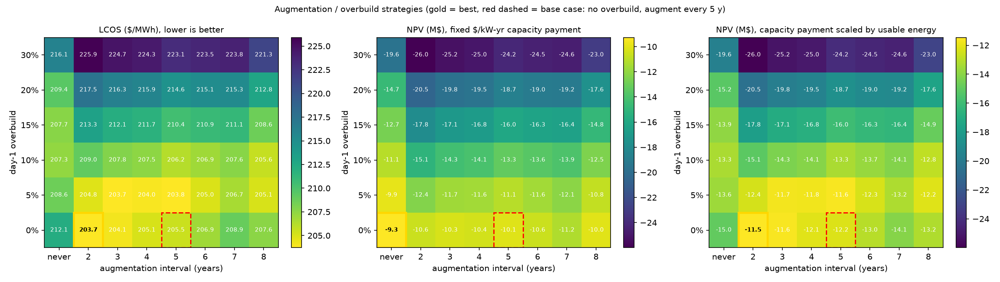
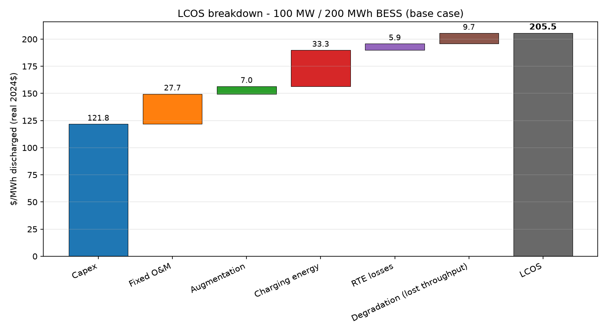
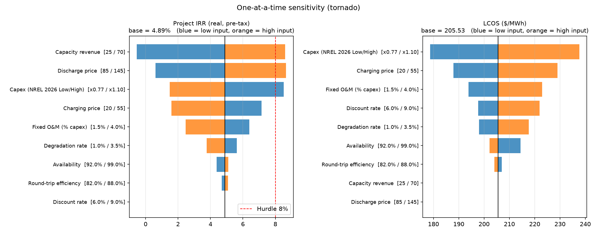
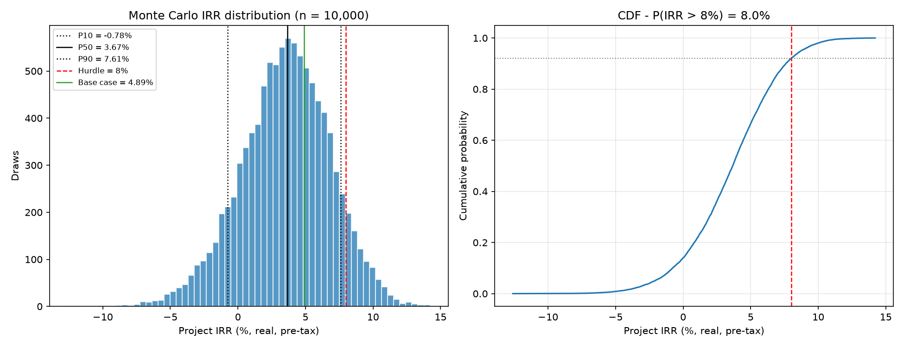
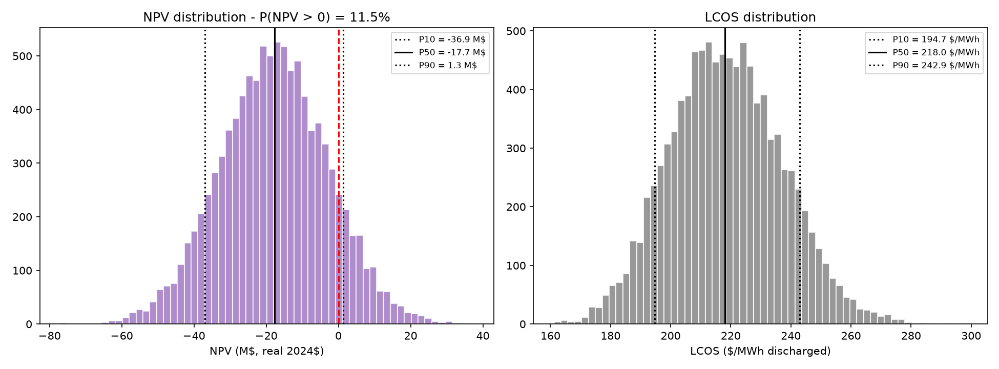
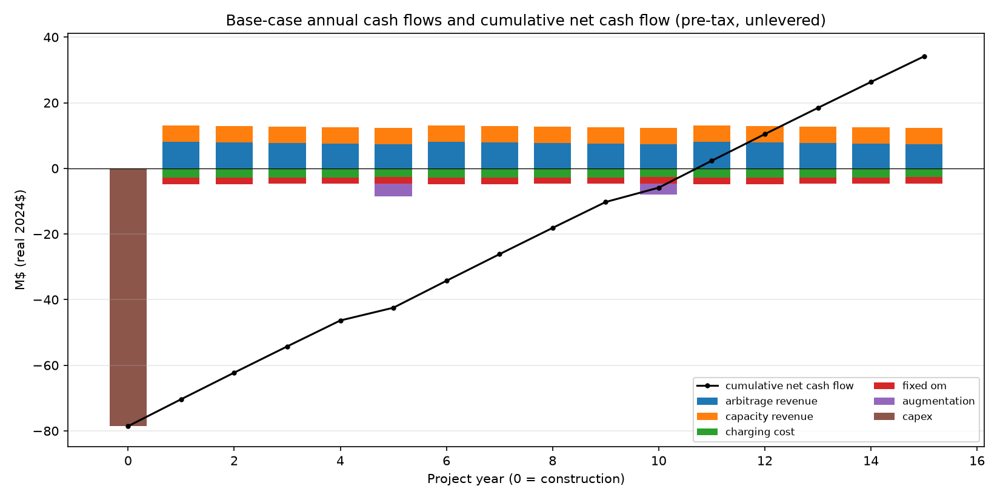

# BESS LCOS & Monte Carlo Project IRR

A compact, transparent **techno-economic toolkit for a utility-scale battery energy storage system (BESS)**:
Levelized Cost of Storage (LCOS) with a component breakdown, an annual project cash-flow model (NPV, IRR, payback),
one-at-a-time tornado sensitivity, a 10,000-draw Monte Carlo over the uncertain inputs, and an
augmentation / overbuild strategy study that asks how a fading battery should be topped up.

Case study: **100 MW / 200 MWh (2-hour) lithium-ion BESS**, 15-year life, real 2024 US$, pre-tax, unlevered.
Capital cost inputs come from NREL's *Cost Projections for Utility-Scale Battery Storage: 2025 Update*.
**Revenue inputs are synthetic.** This is a method demo, not an investment case for a real project.

---

## Key results (base case, from `python run_all.py`)

| Metric | Value |
|---|---|
| Overnight capex | **78.57 M$** (785.7 $/kW · 392.8 $/kWh) |
| **LCOS** | **205.53 $/MWh** discharged |
| NPV @ 7 % real | **−10.08 M$** |
| Project IRR (real, pre-tax) | **4.89 %** (hurdle 8 %) |
| Simple payback | 10.72 years (discounted payback not reached within 15-year life) |
| Year-1 discharged energy | 70,101.9 MWh |
| Implied fixed O&M + augmentation | 3.12 % of capex/yr (NREL 2025 FOM benchmark incl. augmentation: 4 %) |

**Monte Carlo (n = 10,000, seed = 42)**

| | P10 | P50 | P90 |
|---|---|---|---|
| Project IRR | −0.78 % | 3.67 % | 7.61 % |
| NPV @ sampled discount rate | −36.93 M$ | −17.73 M$ | 1.34 M$ |
| LCOS ($/MWh) | 194.67 | 217.99 | 242.90 |

* **P(IRR > 8 % hurdle) = 8.0 %**, P(NPV > 0) = 11.5 %; IRR was defined in all 10,000 draws.
* **Biggest IRR driver (tornado): capacity revenue**, swinging IRR from −0.54 % to 8.61 % over 25–70 $/kW-yr,
  closely followed by the average discharge price (0.60 % to 8.66 %) and capex (8.51 % at the NREL Low multiplier
  to 1.48 % at the High multiplier).
* **Biggest LCOS driver: capex** (178.73 to 237.68 $/MWh across the NREL 2026 Low/High range), then charging price.
* Monte Carlo Spearman rank correlation with IRR: capacity revenue +0.55, discharge price +0.51, capex −0.41,
  charging price −0.34, fixed O&M −0.25, degradation −0.12 (others |ρ| < 0.05).
* The Monte Carlo P50 IRR (3.67 %) is below the base case (4.89 %) because several input distributions are
  deliberately skewed toward the downside (higher charging price, O&M and degradation; lower capacity revenue).

**Reading the result:** with these (synthetic) revenues, a 2-hour merchant battery at NREL's 2026 mid-case capex
does not clear an 8 % real hurdle. Revenue certainty (capacity/ancillary contracts, spreads) matters more than
efficiency or availability, and capex is the main lever on LCOS. Change `config/assumptions.yaml` to test your own case.

### Augmentation and overbuild strategy (degradation-aware)

48 strategies = day-1 overbuild (0, 5, 10, 15, 20, 30 % extra energy; usable energy capped at nameplate) ×
augmentation interval (never, or every 2–8 years, topping back up to the design level), each priced with the same
cash-flow/LCOS model (overbuild at build-year NREL energy cost, augmentation on the NREL Mid curve for its calendar
year). Two capacity-revenue rules: a fixed $/kW-yr payment (base case) and one scaled by usable energy, as with
duration-based capacity accreditation (`capacity_credit_tracks_soh`, an ILLUSTRATIVE rule).
Results: `results/augmentation_strategies.csv`, `results/augmentation_robustness.csv`.

| Capacity payment | Base case (no overbuild, augment yrs 5 & 10) | Highest NPV | Lowest LCOS |
|---|---|---|---|
| Fixed $/kW-yr | NPV −10.08 M$, LCOS 205.53 | **never augment: −9.27 M$** (LCOS 212.14) | augment every 2 y: 203.72 $/MWh (NPV −10.58 M$) |
| Scaled by usable energy | NPV −12.24 M$, LCOS 205.53 | **augment every 2 y: −11.46 M$** (LCOS 203.72) | same |

* **LCOS and NPV disagree.** With a fixed capacity payment the strategy with the lowest LCOS is not the most valuable:
  compared with the base case, skipping augmentation raises LCOS by 3 % but adds 0.81 M$ of NPV, because the extra arbitrage throughput from
  augmenting is worth less than the augmentation spend at these (synthetic) spreads.
* **The answer flips with how capacity is paid.** If the capacity payment follows usable energy, not augmenting is the
  worst option among no-overbuild strategies (−14.97 M$) and frequent small top-ups win.
* **Overbuild only pays a little, and only when capacity tracks usable energy**: 5 % overbuild + augment every 5 y is
  −11.59 M$ there (vs −12.24 M$ base), but every overbuild loses NPV under the fixed payment.
* **Robustness (1,000 Monte Carlo draws, same distributions and seed, every strategy on every draw):** with the fixed
  payment "never augment" has the highest NPV in 89.2 % of draws (mean regret 0.06 M$); with the energy-linked
  payment "augment every 2 y" is best in 53.6 % of draws (mean regret 0.08 M$) and "augment every 3 y" in 21.0 %.
  The base-case schedule (every 5 y) is almost never best (0.5 % / 0.0 %), with mean regret 1.12 / 0.76 M$.
* Caveat: augmentation is priced at the bare NREL energy-cost component (no extra integration or outage cost), which
  flatters augmentation, so the "never augment" result under a fixed payment is if anything understated.



### Figures

**LCOS breakdown (waterfall)**


**Tornado sensitivity – IRR and LCOS**


**Monte Carlo IRR distribution and CDF**


**Monte Carlo NPV and LCOS distributions**


**Base-case annual cash flows**


---

## Method

### Capex (NREL energy/power split)
NREL (2025) splits system cost into an energy and a power component:

`Capex ($/kW) = EnergyCost ($/kWh) × Duration (h) + PowerCost ($/kW)`

with 2024 values of 241 $/kWh and 372 $/kW. The 2026 build year is priced with NREL's normalised 4-hour cost
trajectory (Table 2, 2026: Low 0.77 / Mid 0.92 / High 1.10, relative to 2024 = 1.00), applied to both components.

### Physics & degradation
* Annual discharged energy `E_dis,t = P · D · cycles · availability · SOH_t`, charged energy `E_ch,t = E_dis,t / η_RT`.
* Usable energy fades linearly (`annual_fade`); at the end of years 5 and 10 the lost capacity is
  **augmented** back to nameplate. Optional day-1 **overbuild** (`initial_overbuild`) installs extra energy that is
  not usable above nameplate but delays the loss of usable energy (time-average usable SOH is integrated exactly
  across the crossing); augmentation then tops back up to the design level. Augmentation is priced at the NREL energy-cost component scaled by NREL's
  Mid cost-reduction curve for that calendar year (2031: 0.81, 2036: 0.71), keeping the build-year cost ratio.

### LCOS

$$
\mathrm{LCOS}=\frac{\mathrm{CAPEX}_0+\sum_{t=1}^{N}\dfrac{\mathrm{FOM}_t+\mathrm{VOM}_t+\mathrm{AUG}_t+p^{ch}_t\,E^{ch}_t}{(1+r)^t}-\dfrac{\mathrm{RV}_N}{(1+r)^N}}{\sum_{t=1}^{N}\dfrac{E^{dis}_t}{(1+r)^t}}
$$

Breakdown conventions (components sum exactly to the LCOS):
* **Charging energy** = `p_ch · E_dis` (cost of the energy that is actually delivered);
  **RTE losses** = `p_ch · E_dis · (1/η_RT − 1)`.
* Every cost is first levelized over the throughput the battery *would* deliver with no fade; the gap to the
  actual LCOS is shown as **Degradation (lost throughput)**.

### Cash flow, NPV, IRR, payback
Annual real, pre-tax, unlevered cash flows: arbitrage revenue (`E_dis · p_dis`) + capacity/ancillary revenue
(`$/kW-yr · kW`) − charging cost − fixed O&M − variable O&M − augmentation; capex in year 0. NPV at the real
discount rate; IRR by bisection (vectorised for the Monte Carlo); payback with linear interpolation.

### Sensitivity & Monte Carlo
* **Tornado**: each input moved alone to its low/high value (ranges in `config/assumptions.yaml`).
* **Monte Carlo**: 10,000 independent draws (seed 42) – triangular distributions for capex multiplier (NREL
  Low/Mid/High), discharge & charge price, capacity revenue, degradation, availability, fixed O&M and RTE;
  uniform 6–9 % real discount rate (affects NPV/LCOS only, not IRR). Outputs: IRR/NPV/LCOS percentiles,
  P(IRR > hurdle), P(NPV > 0), and Spearman rank correlations.

---

## Assumptions

Source tags: **NREL2025** = verified in the cited report · **ILLUSTRATIVE** = author assumption · **SYNTHETIC** = invented market input.

| Parameter | Base value | Source |
|---|---|---|
| Power / duration / energy | 100 MW / 2 h / 200 MWh | ILLUSTRATIVE design choice |
| Energy cost component (2024) | 241 $/kWh | NREL2025 (Sec. 2.2) |
| Power cost component (2024) | 372 $/kW | NREL2025 (Sec. 2.2; 379 $/kW adjusted down by 7 $/kW) |
| 2026 cost multiplier Low/Mid/High | 0.77 / 0.92 / 1.10 | NREL2025 Table 2 (normalised 4-h cost) |
| Lifetime | 15 years | NREL2025 |
| Round-trip efficiency | 85 % | NREL2025 |
| Variable O&M | 0 $/MWh | NREL2025 |
| Fixed O&M (routine, excl. augmentation) | 2.5 % of capex/yr | ILLUSTRATIVE (NREL2025 uses 4 % *incl.* augmentation; augmentation is modelled explicitly here) |
| Augmentation cost curve | NREL Mid normalised curve | NREL2025 Table 2 |
| Degradation | 2.0 %/yr linear, augment at end of yr 5 and 10 | ILLUSTRATIVE |
| Cycles | 365 full cycles/yr | ILLUSTRATIVE (NREL2025 O&M assumes ~1 cycle/day) |
| Availability | 97 % | ILLUSTRATIVE |
| Average discharge price | 115 $/MWh | **SYNTHETIC** |
| Average charging price | 35 $/MWh | **SYNTHETIC** |
| Capacity / ancillary revenue | 50 $/kW-yr | **SYNTHETIC** |
| Capacity payment rule | fixed per kW (strategy study also tests "scaled by usable energy") | ILLUSTRATIVE |
| Day-1 overbuild | 0 % (strategy study: 0–30 %) | ILLUSTRATIVE |
| Discount rate (real, pre-tax) | 7 % | ILLUSTRATIVE |
| Hurdle IRR (real, pre-tax) | 8 % | ILLUSTRATIVE |
| Residual value / decommissioning | 0 | ILLUSTRATIVE |

Monte Carlo and tornado ranges are listed in [`config/assumptions.yaml`](config/assumptions.yaml).

---

## Data sources & licences

* **Cole, W., Ramasamy, V., & Turan, M. (2025).** *Cost Projections for Utility-Scale Battery Storage: 2025 Update.*
  National Renewable Energy Laboratory, NREL/TP-6A40-93281. https://www.nrel.gov/docs/fy25osti/93281.pdf ·
  OSTI: https://www.osti.gov/biblio/2583471 (doi:10.2172/2583471).
  *Terms:* a U.S. DOE-funded NREL technical report, "available at no cost from NREL". The report does not state an
  open-content licence; this repository only cites individual numeric values (with page/table references) and
  does not redistribute the report's text or figures. Values are for 4-hour, mainland-US systems in 2024$;
  extending them to a 2-hour system uses NREL's own energy/power split.
* **Revenue and market inputs** are synthetic, not taken from any market dataset.

---

## How to run

```bash
python -m venv .venv && source .venv/bin/activate   # Windows: .venv\Scripts\activate
pip install -r requirements.txt
python run_all.py                 # full run (~100 s): figures/ + results/
python run_all.py --draws 1000 --aug-draws 0   # quick run (skips the strategy robustness Monte Carlo)
pytest -q                         # 16 unit tests
```

Outputs: `results/summary.json` (all headline numbers), `results/base_case_cashflows.csv`, `results/tornado.csv`,
`results/mc_rank_correlation_irr.csv`, `results/augmentation_strategies.csv`, `results/augmentation_robustness.csv`, `results/run_log.txt`, and `results/monte_carlo_draws.csv.gz` (regenerated, git-ignored).

## Repository layout

```
config/assumptions.yaml    # every assumption, tagged by source
src/bess_tea/
  config.py                # YAML -> flat parameter dict
  physics.py               # throughput, SOH, overbuild, augmentation schedule
  augmentation.py          # overbuild x augmentation-interval strategy grid + Monte Carlo robustness
  cashflow.py              # capex, annual cash flows, NPV / IRR / payback
  lcos.py                  # LCOS + additive component breakdown
  sensitivity.py           # tornado
  montecarlo.py            # sampling, simulation, percentiles, rank correlation
  plots.py                 # figures
run_all.py                 # end-to-end pipeline
tests/test_model.py        # pytest checks (capex formula, IRR, LCOS additivity, ...)
```

## Limitations

* Revenues are synthetic and constant in real terms; there's no dispatch optimisation, price-shape or cannibalisation
  model, and arbitrage and capacity revenues are simply added together (no co-optimisation or stacking constraints).
* Pre-tax, unlevered and real: no tax, depreciation, ITC/incentives, debt, inflation or working capital.
* Degradation is linear in installed energy, and augmented capacity fades at the same rate as the original. It
  ignores calendar vs. cycle ageing, depth-of-discharge effects, RTE drift, augmentation outages and integration costs.
* The "capacity payment scaled by usable energy" rule is a simple illustration of duration-based accreditation, not
  any specific market's rules.
* Monte Carlo inputs are sampled independently, so correlations (e.g. between spreads and capacity prices) are ignored.
* Capex is a national-average NREL benchmark for 4-hour systems, adapted to 2 hours. Site, grid-connection,
  interconnection and regional costs aren't modelled.
* This is an educational/portfolio model. It hasn't been validated against any operating asset and isn't investment advice.

## License

Code: MIT © 2026 Syed Muhammad Taha Nasir. See [LICENSE](LICENSE). Cited third-party data stays under its own terms (see above).
